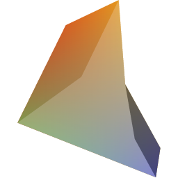
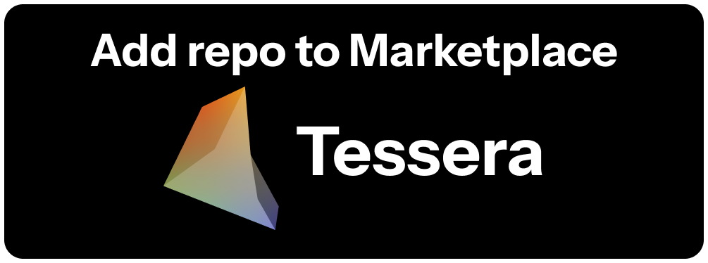

# Tessera Marketplace

Plugins for [Tessera](https://github.com/CompagesWorks/Tessera), the Smash Ultimate modding tool.

## Plugins

**[Browse the plugins →](https://compagesworks.github.io/Tessera-Marketplace/)**

## Install a plugin

1. Open Tessera and go to **Plugins → Marketplace**.
2. Pick a plugin and click **Install**.
3. Review the permissions it asks for, then confirm.

Every download is checked against the SHA-256 listed in [`marketplace.json`](marketplace.json). Tessera refuses a package that does not match.

## Publish your plugin

Open a pull request that adds your package and its entry to `marketplace.json`. See [CONTRIBUTING.md](CONTRIBUTING.md).

Want your own store instead? Any GitHub repository with a `marketplace.json` works, and you can give it the same **Add to Tessera** button. See [Hosting your own marketplace](CONTRIBUTING.md#hosting-your-own-marketplace).
